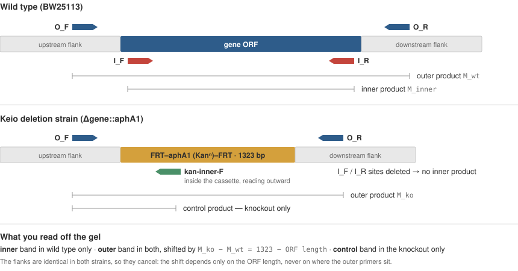

# How the primers are designed

This document is the complete account of what the tool does and why — the assay it
implements, how each primer pair is placed and scored, how the band sizes and the cassette
control are computed, and where the limits are. The [README](../README.md) is the quick
start; this is the part to read before you trust a result.

---

## 1. The problem

The [Keio collection](https://doi.org/10.1038/msb4100050) (Baba *et al.* 2006) is a set of
*E. coli* single-gene deletion strains. In each one, a target gene's open reading frame has
been replaced by a kanamycin-resistance cassette:

```
wild type   …flank───[ gene ORF ]───flank…
knockout    …flank───[ FRT–aphA1–FRT ]───flank…
```

Strains get mislabelled, cross-contaminated, and occasionally carry a partial or
second-site insertion. Before building anything on top of a deletion strain you want
direct evidence that **this colony** has **this gene** replaced by **the cassette**. That is
a PCR question, and a single primer pair answers it badly:

- A pair **inside the ORF** gives no product in the knockout — but "no band" is also what
  a failed PCR looks like. Absence of evidence is not evidence of absence.
- A pair **outside the ORF** always gives a band, so a failure is obvious — but on its own
  it does not prove *what* sits between the primers.

So the tool designs both, and optionally a third reaction that identifies the insert
directly. Each covers the others' blind spot.

## 2. The assay



| | placement | wild type | knockout | what it establishes |
|---|---|---|---|---|
| **Inner pair** (`I_F`/`I_R`) | both inside the ORF | band, `M_inner` | **no product** | the ORF is really gone |
| **Outer pair** (`O_F`/`O_R`) | both in the flanks | band, `M_wt` | band, `M_ko` | the right locus amplified, and the insertion is visible as a size shift |
| **Cassette control** | inside the cassette + the outer primer in the flank it faces | **no product** | band | the insert is the resistance cassette, at this locus |

Read together:

- **wild type** → inner band, outer band at `M_wt`, no control band
- **knockout** → no inner band, outer band at `M_ko`, control band
- **failed reaction** → the outer pair is also missing, so you know to repeat rather than
  misread it as a deletion

### Why the outer shift is fixed

The flanks are identical in both strains, so whatever length they contribute cancels:

```
M_wt = (left flank) + ORF_length    + (right flank)
M_ko = (left flank) + 1323          + (right flank)
──────────────────────────────────────────────────────
M_ko − M_wt = 1323 − ORF_length
```

The shift depends **only on the ORF length** — never on where the outer primers sit. Two
consequences the tool acts on:

- **Short ORFs shift strongly upward.** A 300 bp ORF gives a +1023 bp shift: unmistakable.
- **ORFs near 1323 bp barely move.** `pepQ` (1332 bp) shifts by −9 bp, which no gel will
  resolve. The tool flags any gene whose `|shift|` is below `outer.min_shift_bp` (150 bp by
  default) and tells you to rely on the inner pair there. It does **not** try to fix this by
  moving the primers, because moving them cannot change the shift.

The 1323 bp is the FRT–*aphA1*–FRT cassette from pKD13 (GenBank AY048744.1), measured from
priming site 1 to priming site 4 — the segment that ends up in the chromosome. Change it
with `--cassette-bp` if your marker differs.

## 3. Locating the gene

Coordinates come from *E. coli* K-12 MG1655, accession **`NC_000913.3`**. The Keio parent
strain is BW25113, which is not in the NCBI Gene database; it is sequence-identical to
MG1655 at these loci, so MG1655 is used for lookups.

Two ways in, both producing the same internal `Locus`:

1. **By name** — one Entrez query for the annotated coordinates. A list of gene names is
   all most users need. Synonyms that NCBI knows resolve automatically; anything else can be
   mapped in `reference.gene_aliases`.
2. **By CDS** — an exact match of a supplied sequence against the chromosome, on either
   strand. Independent of naming, and the way to pin down a specific allele.

Around the ORF, `reference.flank_bp` (700 bp by default) of genomic context is taken on each
side to search for the outer pair. The whole window is then written **5'→3' along the gene**,
so that "upstream" and "downstream" mean the same thing for genes on either strand.

The chromosome is downloaded once and cached, so a batch costs one download and later runs
are offline.

### Forward and reverse

primer3 designs on the template it is given, which is the gene-sense strand. For a
minus-strand gene, its "left" primer is the one that reads leftwards along the chromosome —
the opposite of the usual convention. The tool therefore **swaps the forward/reverse labels
back for minus-strand genes**, so `O_F`/`I_F` always mean *forward with respect to the
reference (+) strand*. The oligo sequences are unaffected; only the labels change. (This is
a real trap: an earlier version of this assay mislabelled every minus-strand gene, and the
tests now pin `hslV`'s exact labelled oligos to stop it recurring.)

## 4. Placing the two pairs

### Inner pair — span as much of the ORF as possible

Both primers must sit inside the ORF, since the point is that the knockout has nothing for
them to bind. Within that constraint the pair is pushed to the ORF's two ends:

- the product-size window is `[ORF_length − inner.max_end_window_bp, ORF_length]`, so
  primer3 may search at most 80 bp in from each end;
- `PRIMER_PRODUCT_OPT_SIZE` is the full ORF length, and near-full-length products are
  rewarded, so the chosen pair spans as much of the ORF as the quality criteria allow.

A wide span matters because it makes the result robust to a *partial* deletion: a pair
sitting in the middle of a long ORF would still be lost in a clean knockout, but would also
miss an insertion that removed only one end. Coverage below `inner.min_coverage_frac` (80%)
is reported. In practice the designs come out around 98%.

The tool then **verifies** that both inner primers really do fall within the ORF, rather than
assuming primer3 honoured the window. A primer that has slipped outside would still amplify
in the knockout and silently invert the assay's logic.

### Outer pair — in the flanks, close to the ORF

`SEQUENCE_TARGET` covers the whole ORF, which forces primer3 to place both primers outside
it. The product-size window is `[ORF + product_margin.min, ORF + product_margin.max]` —
60 to 300 bp of flank in total, optimum 150 — which keeps both bands small enough to run
quickly and size accurately. Since the shift is placement-independent, there is nothing to
gain from larger products.

Because no primer can be further from the ORF than `product_margin.max`, the search is
restricted to that window rather than the full fetched flank. This is purely a speed
measure: the candidate set is unchanged, but primer3 has far fewer pairs to evaluate.

The tool then verifies that neither outer primer **overlaps** the ORF. One that does would
be deleted in the knockout, giving no product exactly where a product is needed.

## 5. The cassette (kanamycin) control

The inner and outer pairs together prove the ORF is gone and that something of the right
size replaced it. They do not prove the insert is the cassette. The control does: a primer
**inside** the resistance cassette, reading **outward**, paired with the outer primer in the
flank it points at.

- In the **knockout** the two converge across the cassette-chromosome junction → band.
- In **wild type** there is no cassette, so the control primer has nowhere to bind → nothing.

It is therefore the mirror image of the inner pair, and the two together are a much stronger
statement than either alone: *the ORF is absent* **and** *the cassette is present, here*.

The default control primer is `CATACGCTTGATCCGGCTAC`, which lies within *aphA1* and reads
out toward the FRT/priming-site-1 end — the gene's 5' junction.

**Which outer primer is the partner is computed, not assumed.** The tool builds the modelled
knockout allele (`upstream flank + cassette + downstream flank`), finds where the control
primer and both outer primers actually bind it, and selects the one that is on the opposite
strand *and* points back at the control primer — a convergent pair. The product length is
read off those binding sites. Geometrically this works out to `O_F` for plus-strand genes
and `O_R` for minus-strand genes, but the tool derives it per gene, so it stays correct for a
custom cassette or control primer.

The output reports **both the label and the sequence** of the partner. Forward/reverse
conventions genuinely differ between labs and sheets, and a label mix-up here costs a failed
reaction; the sequence is unambiguous. If you get no band, try the other outer primer before
suspecting the strain.

Switch the control off with `--no-control`, or point it at a different cassette with
`control.sequence` and `cassette.sequence_fasta`.

## 6. Quality criteria

Every oligo — designed fresh or supplied by you — is scored with
[primer3](https://github.com/libnano/primer3-py) and flagged against the criteria in
`criteria.yaml`. Defaults:

| criterion | default | why |
|---|---|---|
| length | 20–30 nt (opt 22) | long enough to be specific, short enough to synthesise cheaply |
| GC content | 40–60% | balanced binding; extremes misbehave |
| Tm (design window) | 55–68 °C, target 60 | one annealing temperature for every reaction in the batch |
| Tm (accept) | 50–72 °C | outside this a primer is flagged even if it was supplied, not designed |
| pair Tm difference | ≤ 3 °C | both primers must work at the same annealing temperature |
| hairpin Tm | ≤ 40 °C | a folded primer cannot prime |
| self-dimer Tm | ≤ 45 °C | primers that pair with themselves are not available to bind the template |
| 3'-end self-complementarity Tm | ≤ 35 °C | the 3' end is what extends; dimers there are the worst kind |
| cross-dimer Tm | ≤ 45 °C | the two primers of a pair must not stick to each other |
| run of identical bases | ≤ 4 | long homopolymers slip and misprime |

Thermodynamics are computed at `salt_monovalent_mM` 50 and `dna_conc_nM` 250 — set these to
your own PCR conditions if they differ, since Tm depends on both.

Two things are checked beyond primer3:

- **Specificity.** Every primer is matched against the entire chromosome, both strands. More
  than one exact match means the primer can prime elsewhere and give extra bands, so it is
  flagged. This is an exact-match screen, not a full alignment: it catches repeats and
  duplicated genes, but will not catch a primer that mis-primes with one or two mismatches.
  For a borderline-critical primer, a BLAST check is still worth doing.
- **Placement**, as described above — inner inside the ORF, outer outside it.

### Nothing is relaxed silently

If primer3 cannot meet the criteria, it returns nothing and the gene is reported as a
failure. The tool never quietly widens a window to make a gene pass, because a primer that
passes only under secretly-loosened criteria is worse than a reported failure: you would
order it believing it met the spec. Genes that fail are written to a separate
`*_failed.csv` with the reason, and you decide whether to relax a threshold (`--tm`, `--gc`,
`--set …`) and re-run.

A gene marked `check` is different from a failure: primers exist, but something is worth
your attention — most often a small outer shift. Read the `Notes` column.

### Existing primers are never overwritten

A gene whose input row carries all four primers is **scored and sized, not redesigned**. An
already-ordered, bench-validated set stays exactly as it is, and you still get its band
sizes and any warning about it. This makes re-running a list safe: new genes get designed,
old ones are left alone.

## 7. Limitations

Worth knowing before you rely on a number:

1. **The knockout allele is modelled, not read.** It is treated as a clean, complete-ORF
   replacement. Real Keio junctions carry a few scar bases, so `M_ko` and the control size
   are accurate to within a handful of bp — fine for reading a gel, not a substitute for
   sequencing the junction if you need base-level certainty.
2. **Annotation is trusted.** The ORF boundaries are NCBI's. A mis-annotated start codon
   shifts the inner primers and the computed shift.
3. **Specificity is exact-match only** (see above).
4. **Tm is a model.** Nearest-neighbour predictions are good but not exact, and real
   annealing behaviour depends on your polymerase, buffer and cycler. Treat the predicted Tm
   as a starting point for your gradient, not a guarantee.
5. **One deletion model.** The assay reports a complete-ORF replacement. A partial deletion,
   a duplication, or a second-site insertion can produce patterns this assay does not
   describe — the wide inner span and the cassette control narrow that gap, but do not close
   it.
6. **No multiplex check.** Primers are checked within a pair, not across pairs. If you
   intend to multiplex inner and outer reactions in one tube, check those combinations
   yourself.

## 8. References

- Baba T. *et al.* (2006) Construction of *Escherichia coli* K-12 in-frame, single-gene
  knockout mutants: the Keio collection. *Mol Syst Biol* **2**:2006.0008.
- Datsenko K.A. & Wanner B.L. (2000) One-step inactivation of chromosomal genes in
  *Escherichia coli* K-12 using PCR products. *PNAS* **97**:6640–6645. (pKD13, the cassette)
- Untergasser A. *et al.* (2012) Primer3 — new capabilities and interfaces. *Nucleic Acids
  Res* **40**:e115.
- SantaLucia J. (1998) A unified view of polymer, dumbbell, and oligonucleotide DNA
  nearest-neighbor thermodynamics. *PNAS* **95**:1460–1465. (the Tm model primer3 uses)
